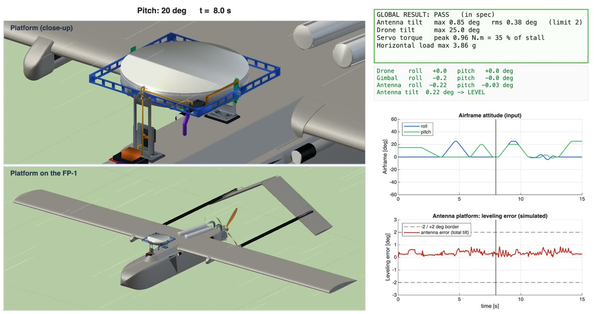
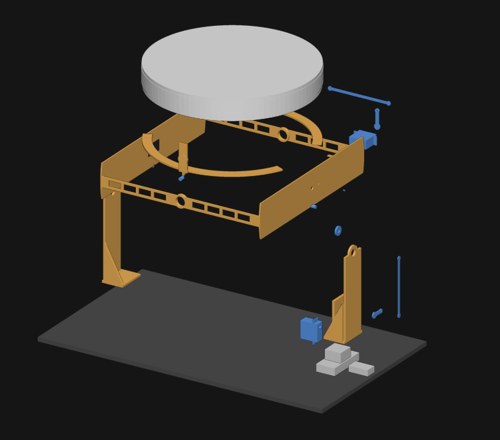
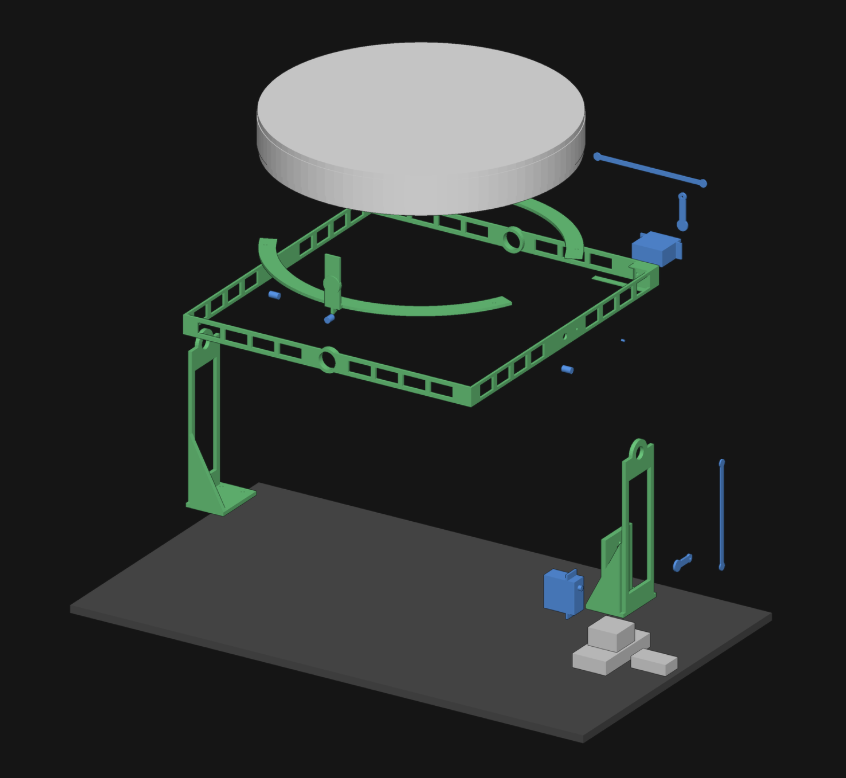

# A leveling platform for a drone antenna

[](media/demo.mp4)

A 15 s replay of the model, with the platform on a fixed-wing airframe. Click the still to play the video.

Satellite links on drones are fragile. Some antennas, CRPA types included, are built to reject jamming and multipath, but their reception pattern is fixed to the antenna body. Bolt one to the airframe and it tilts with every turn: it picks up reflections from the ground, trees and buildings, and the jammer signal gets an easier path into the receiver. The airframe moves all the time and not in a fixed pattern, so the attitude cannot be planned away.

This is a two-axis platform that keeps the antenna level, and so pointed at the sky, through roll and pitch. It costs 170 to 195 € in parts, prints on a hobby 3D printer, and bolts to the aircraft deck. It is standalone: it runs on the flight controller that is already there, so there is no extra IMU, no extra processor and no firmware to maintain.

Built for the Fire Point challenge at the European Defense Tech Hackathon, EDTH, Paris, November 2026. 50 teams, 3 days.

## How it works

Two DSServo DS3240 servos, about 20 € each, move a Cardan gimbal: roll on the outer axis, pitch on the inner one. Both axes pass through the center of gravity of the antenna. A banked turn pulls sideways on any mass above or below the pivots, so pivoting through the middle removes that load; the servos turn the dish instead of holding it up. With a 4 kg antenna the peak servo torque in the tests is 54 % of stall.

The Cube Orange that already flies the aircraft does the control. ArduPilot's servo mount, `MNT1_TYPE = 1`, writes `cmd = -(attitude + 0.07 s * rate)` to two spare AUX outputs, and each servo closes its own position loop. That is feed-forward from the attitude and the rate, not a PID on a second sensor. A closed loop would need another IMU, a controller board and firmware, and it would not remove the delay that the lead term handles.

The platform uses flight controller data that is already computed: roll, pitch and their rotation rates. Airspeed enters the simulated maneuver load. Installation is two servo leads and four bolts.

## What it does

We ran the model against the challenge limits: 45° tilt, 25°/s, turbulence from 0.1 to 1.2 Hz, leveling error at most 2°, antenna mass 2 or 4 kg, and nothing outside a 400 × 400 mm envelope.

| | 4 kg antenna | 2 kg antenna |
|---|---|---|
| In-spec tests passing, 2° limit | 24 / 24 | 24 / 24 |
| Worst tilt over all in-spec tests | 1.39° | 1.23° |
| Peak servo torque, share of derated stall | 54 % | 44 % |
| Motion left on the antenna, 0.1 to 1.2 Hz | 4 to 23 % | 4 to 20 % |

The worst tilt comes from a real Cube Orange log recorded in wind, capped to 45° and 25°/s. The 45°/45° envelope corner gives 0.95°. Push one assumption at a time and the design still passes: a 400 Hz mount loop 1.03°, the full rated servo torque 1.14°, double gear play 1.36°, a 20 mm residual center of gravity offset 1.42°, and a 10 mm sideways offset 1.73°.

The platform misses the 2° limit when the setup is off. A level calibration error of 0.5° on the flight controller gives 2.04°. Removing the rate lead gives 3.27°. A servo that drives at full power from 4° instead of 2° gives 1.94°, which is marginal. Three things matter: set `MNT1_LEAD_RLL` and `MNT1_LEAD_PTCH`, calibrate the Cube level to 0.3° or better, and use a servo that holds torque without droop.

Beyond the brief it does not hold. Real logs as flown, with banks to 84°, 200 °/s and hand launches, give 3° to 34°. Motion between 3 and 10 Hz is amplified, 2.3 times at 5 Hz. Rubber dampers under the posts are required: without them the 40 Hz engine vibration test drives the servo gears past stall.

## Geometry

<p>


</p>

Exploded views. Grey is the antenna, blue is the servo drive, orange and green are the printed structure, and the plate stands in for the aircraft deck.

The frame wraps the Ø370 × 50 mm antenna and holds it by the six M4 tabs on its back, not by the radome. The posts sit between ±195 mm and ±200 mm, so the outside lands on the 400 mm limit with nothing to spare, and the arms clear the rim by 0.5 mm. Two 1:1 parallelogram linkages keep both servos inside the envelope. The clearance sweep runs roll ±50° against pitch ±45° in 5° steps and finds no contact; the closest pair is 1.0 mm apart.

## Parts and cost

The benchmark prototype costs 170 to 195 €: two servos at 20 € each, four aluminium horns, 608ZZ and 688ZZ bearings, an 8 mm shaft, ball links, M3 rod, screws and inserts, a 6 V UBEC with a capacitor, and 0.5 kg of PETG. The structure is 369 g in PETG or 784 g in aluminium 6061. Print the PETG version for the bench and fly the aluminium one: a printed frame around a 4 kg antenna has its first mode near 10 Hz.

## What is in this repository

| Path | Contents |
|---|---|
| `sim/final_gimbal.slx` | Simscape Multibody model: prescribed airframe attitude, ArduPilot mount timing, servo model, two joints, CAD meshes |
| `sim/build_model.m` | Generates the model from the STLs. The `.slx` is a build product, do not edit it by hand |
| `sim/gimbal_params.m` | Every parameter with its source: measured, CAD, datasheet, brief or assumed |
| `cad/build_gimbal.py` | Parametric CAD: geometry, clearance sweep, mass properties, torque budget. Writes `cad/stl/` and `cad/gimbal_results.json` |
| `cad/stl/` | STLs the model imports: the printed parts and dummies for the antenna, servos and cable |
| `media/` | The demo video and the images in this README |

Not included: the test harness and flight logs behind the numbers, the live telemetry bridge, the electronics schematic and the bench recordings.

## Run the model

Needs MATLAB R2024b or newer with Simulink, Simscape, Simscape Multibody and Stateflow.

```matlab
cd sim
build_model
```

Run `build_model` after a fresh clone. The `.slx` stores absolute paths to the STL files, so a model copied from another computer loads without its CAD geometry. It also writes the input variable `air_in` that the model reads. Then open `final_gimbal.slx` and press Run. It starts from zero attitude, which is level flight.

`air_in` lives in the MATLAB workspace, so run `build_model` again after a MATLAB restart.

For the CAD, install manifold3d, numpy and matplotlib, then run `python cad/build_gimbal.py`. It writes the STLs and the results JSON; the full 5° sweep takes several minutes.

## Limits

- Feed-forward on a stock 50 Hz ArduPilot mount loop. In the 0.1 to 1.2 Hz band it passes with 4 to 23 % of the motion left. At 3 to 10 Hz it amplifies, and outside the 45° envelope it loses the limit.
- Bench test the servos before trusting the numbers. The model uses 28 kg·cm at 6 V, 70 % of the seller rating, and 0.5° of total play per axis. Droop and backlash break the 2° result first.
- The results are simulation on real flight logs, not a flight test of the platform.
